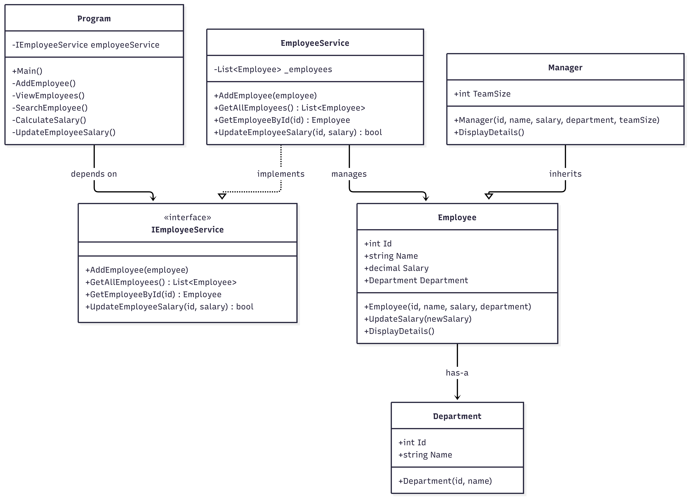

# Employee Management Console Application

A simple C# console application created as part of the .NET Training – Week 1, Day 1 practical work.

The application demonstrates C# fundamentals including variables, data types, methods, conditional statements, loops, collections, nullable handling, and input validation.

## Features

- Add an employee
- View all employees
- Search for an employee by ID
- Calculate an employee's salary with a 10% bonus
- Validate employee ID, name, department, and salary inputs
- Display a menu until the user chooses to exit

## Technology

- C#
- .NET 10 SDK
- .NET Console Application
- `List<Employee>` for in-memory employee storage

## Prerequisites

Install the .NET 10 SDK. Verify the installation from PowerShell:

```powershell
dotnet --version
```

## Project Setup

1. Open a terminal in the directory containing `EmployeeManagement.csproj`.
2. Restore dependencies and build the project:

```powershell
dotnet restore
dotnet build
```

# Day 1

## Run the Application

Execute:

```powershell
dotnet run
```

The application displays this menu:

```text
===== Employee Management =====
1. Add Employee
2. View Employees
3. Search Employee
4. Calculate Salary
5. Exit
```

## Sample Inputs and Outputs

### Sample 1: Add an employee

**Input**

```text
Enter choice: 1
Enter ID: 101
Enter Name: Arun
Enter Department: IT
Enter Salary: 45000
```

**Output**

```text
Employee added successfully.
```

### Sample 2: View employees

After adding the employee shown in Sample 1:

**Input**

```text
Enter choice: 2
```

**Output**

```text
101 | Arun | IT | 45000
```

### Sample 3: Calculate employee salary

After adding the employee shown in Sample 1:

**Input**

```text
Enter choice: 4
Enter Employee ID: 101
```

**Output**

```text
Basic Salary: 45000
Bonus: 4500.00
Total Salary: 49500.00
```

## Input Validation

The application checks that:

- Employee ID is a valid positive integer.
- Duplicate employee IDs are not allowed.
- Employee name and department are not empty.
- Salary is a valid non-negative decimal value.
- Invalid menu selections are rejected.
- Searching for an unknown employee displays an appropriate message.

## Important Notes and Limitations

- Employee records are stored in an in-memory `List<Employee>`.
- Data is not saved to a file or database.
- All employee records are lost when the application exits.
- The salary calculation adds a fixed 10% bonus to the employee's basic salary.
- This is a learning project, not a production-ready employee management system.

## Concepts Practised

| Concept | Application |
|---|---|
| Variables and data types | Employee ID, name, department, and salary |
| Methods | Add, view, search, and calculate salary |
| Classes and objects | `Employee` class and employee instances |
| Collections | `List<Employee>` |
| Conditional statements | Menu selection and input validation |
| Loops | Repeated menu and employee listing |
| Nullable types | Handling potentially missing console input and search results |
| Input handling | Validating user-provided values |


# Day 2

## UML diagram



## SOLID Principles – Employee Management Project

SOLID represents five object-oriented design principles that make code maintainable, reusable, and extensible.

| Principle | Explanation | Project Example |
|---|---|---|
| **S – Single Responsibility Principle (SRP)** | Each class should have one responsibility. | Employee handles employee data; EmployeeService handles employee operations. |
| **O – Open/Closed Principle (OCP)** | Extend functionality without modifying existing code. | Manager overrides `DisplayDetails()` to add team information. |
| **L – Liskov Substitution Principle (LSP)** | Child classes should work wherever parent classes are expected. | Manager object can be assigned to an Employee reference. |
| **I – Interface Segregation Principle (ISP)** | Interfaces should contain only relevant methods. | IEmployeeService defines focused employee operations. |
| **D – Dependency Inversion Principle (DIP)** | Depend on abstractions rather than concrete classes. | Program uses IEmployeeService instead of depending directly on EmployeeService. |

## Overall Summary

The project applies SOLID principles using classes, inheritance, method overriding, and interfaces to improve code organization, maintainability, and future extensibility.