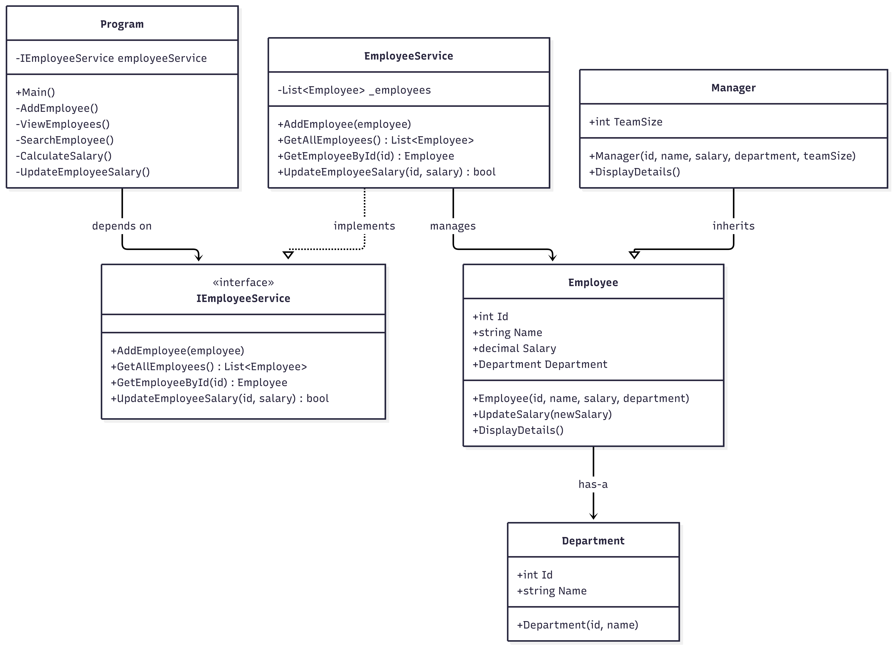

# Employee Management Console Application

A simple C# console application created as part of the .NET Training – Week 1, Day 1 practical work.

The application demonstrates C# fundamentals including variables, data types, methods, conditional statements, loops, collections, nullable handling, and input validation.

## Features

- Add an employee
- View all employees
- Search for an employee by ID
- Calculate an employee's salary with a 10% bonus
- Validate employee ID, name, department, and salary inputs
- Display a menu until the user chooses to exit

## Technology

- C#
- .NET 10 SDK
- .NET Console Application
- `List<Employee>` for in-memory employee storage

## Prerequisites

Install the .NET 10 SDK. Verify the installation from PowerShell:

```powershell
dotnet --version
```

## Project Setup

1. Open a terminal in the directory containing `EmployeeManagement.csproj`.
2. Restore dependencies and build the project:

```powershell
dotnet restore
dotnet build
```

# Day 1

## Run the Application

Execute:

```powershell
dotnet run
```

The application displays this menu:

```text
===== Employee Management =====
1. Add Employee
2. View Employees
3. Search Employee
4. Calculate Salary
5. Exit
```

## Sample Inputs and Outputs

### Sample 1: Add an employee

**Input**

```text
Enter choice: 1
Enter ID: 101
Enter Name: Arun
Enter Department: IT
Enter Salary: 45000
```

**Output**

```text
Employee added successfully.
```

### Sample 2: View employees

After adding the employee shown in Sample 1:

**Input**

```text
Enter choice: 2
```

**Output**

```text
101 | Arun | IT | 45000
```

### Sample 3: Calculate employee salary

After adding the employee shown in Sample 1:

**Input**

```text
Enter choice: 4
Enter Employee ID: 101
```

**Output**

```text
Basic Salary: 45000
Bonus: 4500.00
Total Salary: 49500.00
```

## Input Validation

The application checks that:

- Employee ID is a valid positive integer.
- Duplicate employee IDs are not allowed.
- Employee name and department are not empty.
- Salary is a valid non-negative decimal value.
- Invalid menu selections are rejected.
- Searching for an unknown employee displays an appropriate message.

## Important Notes and Limitations

- Employee records are stored in an in-memory `List<Employee>`.
- Data is not saved to a file or database.
- All employee records are lost when the application exits.
- The salary calculation adds a fixed 10% bonus to the employee's basic salary.
- This is a learning project, not a production-ready employee management system.

## Concepts Practised

| Concept | Application |
|---|---|
| Variables and data types | Employee ID, name, department, and salary |
| Methods | Add, view, search, and calculate salary |
| Classes and objects | `Employee` class and employee instances |
| Collections | `List<Employee>` |
| Conditional statements | Menu selection and input validation |
| Loops | Repeated menu and employee listing |
| Nullable types | Handling potentially missing console input and search results |
| Input handling | Validating user-provided values |


# Day 2

## UML diagram



## SOLID Principles – Employee Management Project

SOLID represents five object-oriented design principles that make code maintainable, reusable, and extensible.

| Principle | Explanation | Project Example |
|---|---|---|
| **S – Single Responsibility Principle (SRP)** | Each class should have one responsibility. | Employee handles employee data; EmployeeService handles employee operations. |
| **O – Open/Closed Principle (OCP)** | Extend functionality without modifying existing code. | Manager overrides `DisplayDetails()` to add team information. |
| **L – Liskov Substitution Principle (LSP)** | Child classes should work wherever parent classes are expected. | Manager object can be assigned to an Employee reference. |
| **I – Interface Segregation Principle (ISP)** | Interfaces should contain only relevant methods. | IEmployeeService defines focused employee operations. |
| **D – Dependency Inversion Principle (DIP)** | Depend on abstractions rather than concrete classes. | Program uses IEmployeeService instead of depending directly on EmployeeService. |

## Overall Summary

The project applies SOLID principles using classes, inheritance, method overriding, and interfaces to improve code organization, maintainability, and future extensibility.


# Day 3 – LINQ Exercises
## Employee and Department Management

### Sample Input

| ID | Employee | Department | Salary |
|---|---|---|---:|
| 101 | Arun | IT | 25000 |
| 102 | Kamala | HR | 60000 |
| 103 | Vimal | IT | 45000 |
| 104 | Sri | Finance | 50000 |

Total employees: 4

---

### Query 1 – Filter Employees by Department

**LINQ:** Where

**Input:** Employee collection, department = IT

**Output:**
- Arun
- Vimal

**Time Complexity:** O(n)

**Explanation:** Iterates through the employee collection and selects employees belonging to IT.

---

### Query 2 – Filter Employees by Minimum Salary

**LINQ:** Where

**Input:** Employee collection, minimum salary = 50000

**Output:**
- Kamala – 60000
- Sri – 50000

**Time Complexity:** O(n)

**Explanation:** Checks every employee's salary and returns employees earning at least 50000.

---

### Query 3 – Sort Employees by Salary Ascending

**LINQ:** OrderBy

**Input:** Employee collection

**Output:**
1. Arun – 25000
2. Vimal – 45000
3. Sri – 50000
4. Kamala – 60000

**Time Complexity:** O(n log n)

**Explanation:** Sorts employees from the lowest salary to the highest salary.

---

### Query 4 – Sort Employees by Salary Descending

**LINQ:** OrderByDescending

**Input:** Employee collection

**Output:**
1. Kamala – 60000
2. Sri – 50000
3. Vimal – 45000
4. Arun – 25000

**Time Complexity:** O(n log n)

**Explanation:** Sorts employees from the highest salary to the lowest salary.

---

### Query 5 – Select Employee Names

**LINQ:** Select

**Input:** Employee collection

**Output:**
- Arun
- Kamala
- Vimal
- Sri

**Time Complexity:** O(n)

**Explanation:** Projects employee objects into a collection containing only employee names.

---

### Query 6 – Group Employees by Department

**LINQ:** GroupBy

**Input:** Employee collection

**Output:**

IT:
- Arun
- Vimal

HR:
- Kamala

Finance:
- Sri

**Time Complexity:** O(n) average

**Explanation:** Groups employees according to their department.

---

### Query 7 – Count Employees by Department

**LINQ:** GroupBy, Select, Count

**Input:** Employee collection

**Output:**
- IT: 2
- HR: 1
- Finance: 1

**Time Complexity:** O(n) average

**Explanation:** Groups employees by department and calculates the number of employees in each group.

---

### Query 8 – Search Employee by Name

**LINQ:** FirstOrDefault

**Input:** Employee collection, search name = Sri

**Output:**
- Employee ID: 104
- Name: Sri
- Department: Finance
- Salary: 50000

**Time Complexity:** O(n)

**Explanation:** Searches for the first employee whose name matches the requested name. Returns null when no match exists.

---

## Complexity Summary

| Query | Operation | Time Complexity |
|---|---|---|
| 1 | Where | O(n) |
| 2 | Where | O(n) |
| 3 | OrderBy | O(n log n) |
| 4 | OrderByDescending | O(n log n) |
| 5 | Select | O(n) |
| 6 | GroupBy | O(n) average |
| 7 | GroupBy + Select + Count | O(n) average |
| 8 | FirstOrDefault | O(n) |

Here, n represents the total number of employees.

Note: Grouping complexities assume hash-based grouping. Sorting complexities assume comparison-based sorting.

## Day 4

## Test Cases Execution Log

```text
Restore complete (0.4s)
  EmployeeDepartmentManagement.Models net10.0 succeeded (0.2s) → D:\Practice\.NET\Employee_and_department_management\EmployeeDepartmentManagement.Models\bin\Debug\net10.0\EmployeeDepartmentManagement.Models.dll
  EmployeeDepartmentManagement.Tests net10.0 succeeded (0.4s) → bin\Debug\net10.0\EmployeeDepartmentManagement.Tests.dll
[xUnit.net 00:00:00.00] xUnit.net VSTest Adapter v3.1.4+50e68bbb8b (64-bit .NET 10.0.14)
[xUnit.net 00:00:00.08]   Discovering: EmployeeDepartmentManagement.Tests
[xUnit.net 00:00:00.14]   Discovered:  EmployeeDepartmentManagement.Tests
[xUnit.net 00:00:00.16]   Starting:    EmployeeDepartmentManagement.Tests
[xUnit.net 00:00:00.24]   Finished:    EmployeeDepartmentManagement.Tests
  EmployeeDepartmentManagement.Tests test net10.0 succeeded (1.3s)
```

## Test Cases Execution Log

Test summary: total: 16, failed: 0, succeeded: 16, skipped: 0, duration: 1.3s
Build succeeded in 2.7s